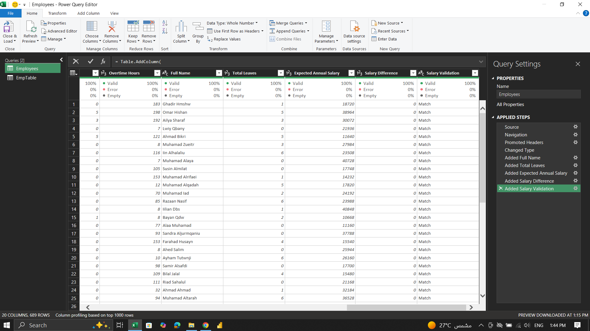
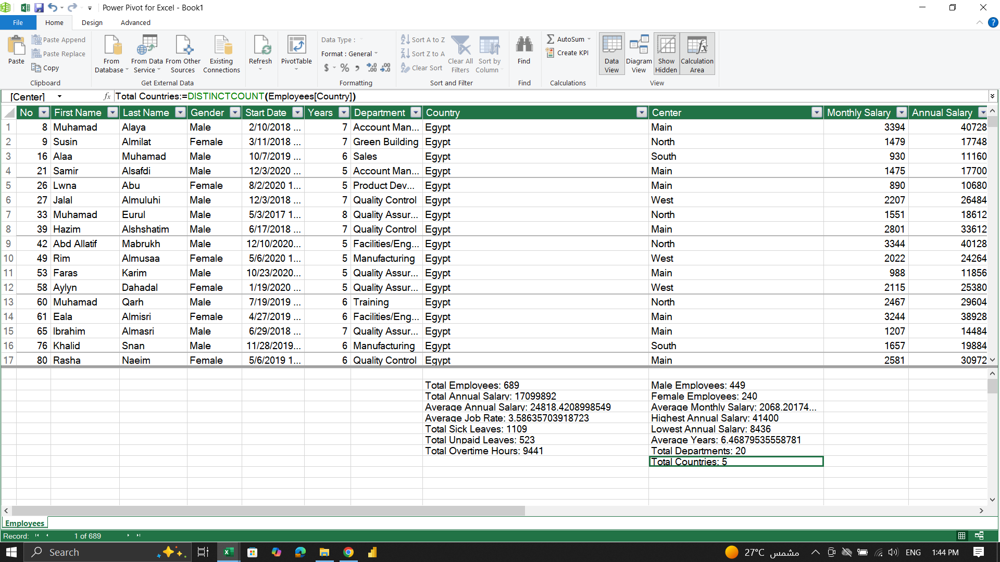
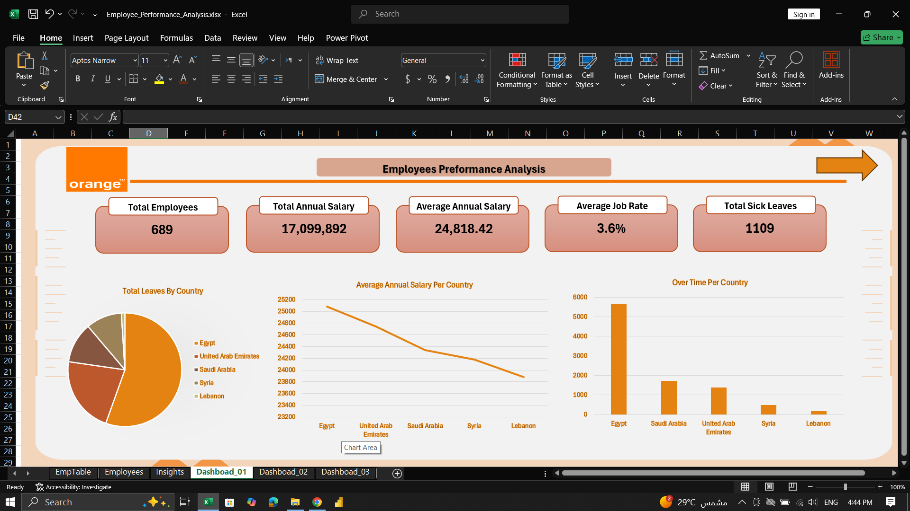
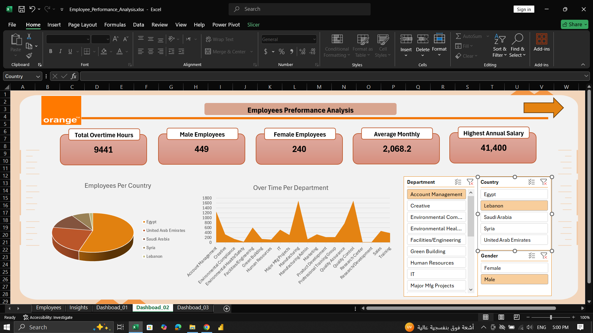
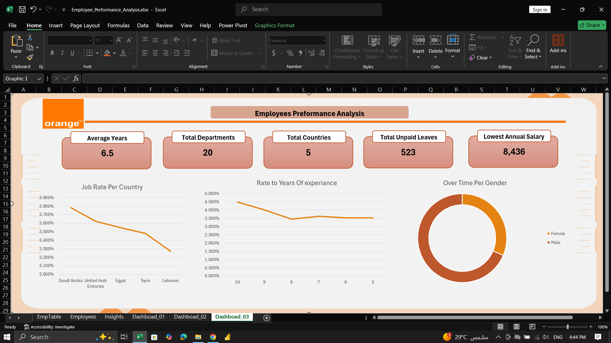

# Employees Performance Analysis 📊

An Excel project focused on analyzing employee data using **Power Query, DAX, Pivot Tables, and Excel Dashboards**.

## 🛠️ Tools Used
- Microsoft Excel
- Power Query
- Power Pivot & DAX
- Pivot Tables & Charts

## ⚙️ Project Workflow
1. Data cleaning and transformation using Power Query.
2. Creating DAX measures using the Excel Data Model.
3. Building Pivot Tables for employee analysis.
4. Creating interactive dashboards to visualize insights.

## 📸 Project Screenshots

### 1. Data Cleaning — Power Query

### 2. DAX Measures

### 3. Pivot Tables

### 4. Dashboard

## 📁 Project Files
- `Employee_Performance_Analysis.xlsx` — The complete Excel project.
- `Data/` — Project data files.
- Screenshots — Documentation of the analysis process.

---
**Author:** [Ibrahem Shenouda](https://github.com/ibrahemshenouda)
